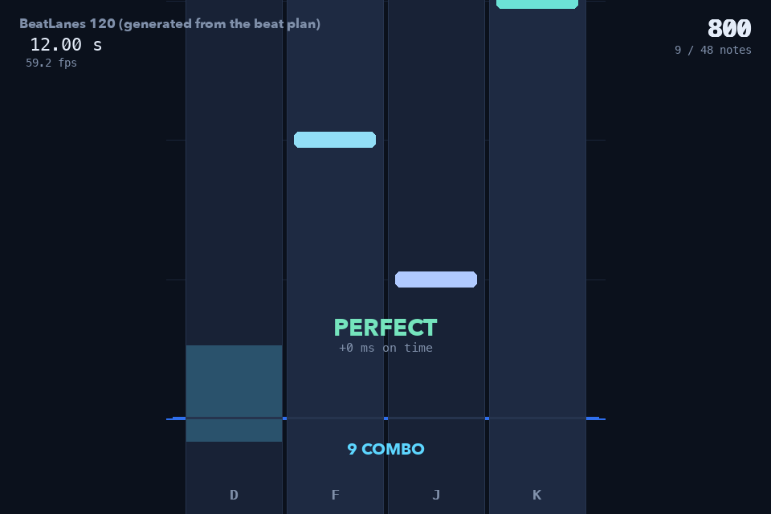

# BeatLanes

A four lane keyboard rhythm game for PC, written in Python with Pygame.

Notes fall down four lanes and you hit **D F J K** as they reach the judgement
line. The interesting part is not the falling rectangles: it is the clock. A
rhythm game is a program that has to decide whether a key press landed on a beat,
and BeatLanes does that by comparing the moment of the press against the moment
the note was supposed to arrive, in milliseconds.



---

## Run it

```bash
pip install -r requirements.txt
python main.py
```

| Screen | Keys |
| --- | --- |
| Title | `SPACE` start, `C` calibrate, `LEFT` `RIGHT` change chart, `ESC` quit |
| Playing | `D` `F` `J` `K` the four lanes, `TAB` debug overlay, `ESC` end the run |
| Results | `R` play again, `T` title, `ESC` quit |
| Calibration | any lane key on each click, `ESC` cancel |

Tested on macOS with Python 3.13.9 and Pygame 2.6.1. Nothing is pinned to a
platform: Pygame handles the window, the keyboard, the mixer and the clock.

## What you are looking at while it runs

The `TAB` overlay shows both clocks at once, which is the whole design argument
of the project in one box:

```
DEBUG                 TAB
tick clock     12016.0 ms     <- the clock the judgement uses
raw ticks           12143     <- pygame.time.get_ticks()
mixer get_pos       12009     <- the mixer's own reading, checked against it
drift               +7 ms     <- the difference between the two
offset              +0 ms     <- what the metronome test measured
fps                  59.2
```

The judgement clock is built from `pygame.time.get_ticks()`, sampled when the key
press is handled, minus the tick reading taken when the music started, minus the
calibration offset. `pygame.mixer.music.get_pos()` is read as well and shown
beside it, but it never decides a verdict: the Pygame documentation only promises
that it reports how long the music has been playing, and it does not account for
the buffer at the start of the track. It is a second opinion, not the clock.

## How a tap becomes a verdict

One subtraction, in `beatlanes/judge.py`:

```
error = tap_ms - target_ms
```

Negative means early, positive means late, and the absolute value picks the
verdict:

| |error| | verdict |
| --- | --- |
| <= 50 ms | `PERFECT` |
| <= 120 ms | `GOOD` |
| more | the press is not counted against that note |

A note nobody hits is marked `MISS` once the song has walked 120 ms past it. A
press that no note is close enough to is counted as a stray tap: it does not
consume a note and does not break the combo, but a run full of them usually means
the calibration offset is wrong.

## The files

```
main.py                  entry point and command line options
beatlanes/
  config.py              every shared setting: lane geometry, windows, colours
  judge.py               error = tap - target, and the PERFECT/GOOD/MISS rules
  chart.py               loading and checking chart JSON
  songclock.py           the tick clock, the mixer reading, and the offset
  scoring.py             combo, score, accuracy and rank
  session.py             one play-through: note states, taps, misses
  logbook.py             the CSV tap log, writing and reading back
  calibration.py         the tap-to-metronome offset, and saving it
  audio.py               mixer setup, the metronome click, the song
  render.py              drawing only - no timing rules live here
  app.py                 states, events and the frame loop
tools/
  beatplan.py            the beat grid the song and the chart are both built from
  make_song.py           generates assets/beatlanes_120.ogg
  make_chart.py          generates charts/beatlanes_120.json
  analyse_log.py         reads a tap log and reports on the timing
charts/
  beatlanes_120.json     48 notes over 16 bars
assets/
  beatlanes_120.ogg      33 seconds, generated by tools/make_song.py
tests/                   97 unit tests
logs/                    tap logs from your own runs land here
docs/shots/              screenshots used in the written reflection
```

## Where the song comes from

There is no downloaded audio anywhere in this repository. `tools/make_song.py`
synthesises the backing track from scratch with numpy: a kick whose pitch drops
and whose amplitude decays, hats made of short noise bursts, a bass line, and a
triangle wave arpeggio.

```bash
python tools/make_song.py     # writes assets/beatlanes_120.ogg
python tools/make_chart.py    # writes charts/beatlanes_120.json
```

Both read `tools/beatplan.py`, so the notes and the drums are placed on the same
beat grid: the chart cannot drift out of time with the song, because the times of
both come from the same four numbers. Generating the audio also means there is no
third party licence to track and no download link that can go dead.

## Tests, and the automatic run

```bash
python -m unittest discover -s tests -t .    # 97 tests
python main.py --selftest                    # play a whole chart and check it
python main.py --autoplay                    # watch a run without touching the keys
python main.py --screenshot out.png --at 12000 --shot-taps
python tools/analyse_log.py logs/taps-*.csv --plot docs/shots/histogram.png
```

`--selftest` plays the chart headlessly with a prepared list of taps whose timing
errors cover all three windows, then prints what it expected against what
happened. It is the same code path as a normal run: same session, same
judgement, same log.

`--autoplay` does the same thing in a real window with real sound, which is how a
log gets real mixer readings in it. `--windowed --screenshot` uses the same trick
to capture a frame at a chosen moment, and the screenshots in `docs/shots/` were
made that way.

## Reading a tap log

Every run writes a CSV with one row per note:

```
note_index,lane,target_ms,tap_ms,error_ms,verdict,mixer_pos_ms
0,0,8000,8000,+0,PERFECT,8008
3,3,9500,9530,+30,PERFECT,9534
6,1,11000,11060,+60,GOOD,11053
11,3,13500,,,MISS,
```

Missed notes still get a row, with the tap and error columns left empty, so the
log shows the shape of a run and not only its successes.

`tools/analyse_log.py` turns a log into the numbers the calibration step needs:

```
all taps   mean    -0.6 ms   median    +0.0 ms   spread  35.4 ms   range -70 to +60 ms
early      mean   -38.3 ms   median   -40.0 ms   ...                 (3 taps)
late       mean   +27.5 ms   median   +22.5 ms   ...                 (4 taps)
tick clock vs mixer        mean    -2.4 ms   median    -4.0 ms   spread   4.7 ms
```

The distinction that matters: a run where every tap is late by roughly the same
amount is a calibration problem, and it is fixed by subtracting an offset. A run
where taps are scattered either side of zero is a player problem, and no offset
will fix it. That is why the tool prints the mean and the median next to each
other.

## Credits

- **Pygame** (2.6.1) - window, input, audio, timing. https://www.pygame.org
- **numpy** - used only by the song generator, for the sample maths.
- **soundfile** - used only by the song generator, to write the OGG.
- **Matthes, E. (2023).** *Python crash course* (3rd ed.), chapters 12-14 - the
  window, the game loop and the event handling follow the structure taught there.
- **Craven, P. (2016).** *Program arcade games* - sound and keyboard handling.
- **Watkiss, S. (2020).** *Beginning game programming with Pygame Zero* - the
  gentler introduction the event loop was checked against.

The lane patterns, the judgement windows, the calibration design and all of the
code in this repository were written for this project. Libraries are listed above
and are also named where they are used in the code.

## If the keys stop responding (Windows, input methods)

Found in week 11 on a Windows machine with a Chinese input method: the first
notes scored, then nothing did, and on the results screen `R` and `T` were dead
while `ESC` still quit.

pygame 2 starts with text input switched on, and SDL switches it back on every
time the window gets focus. That attaches the input method (IME) to the game
window. In Chinese mode the IME takes every letter key, and SDL drops those
presses instead of turning them into `KEYDOWN` events. Keys the IME does not
want - `ESC`, `SPACE`, `TAB`, the arrows - still get through, which is exactly
the pattern above.

The game now calls `pygame.key.stop_text_input()` when the window opens and
again whenever it regains focus, which detaches the IME from the window
(`BeatLanesApp._disable_text_input` in `beatlanes/app.py`, covered by
`tests/test_app.py`). If a machine still shows the problem, switching the
input method to English (`Shift` on the Microsoft Pinyin IME, or `Win + Space`
to another keyboard) before starting is the manual workaround.

Every lane press now lights its key whether it scores or not, so "the key was
not read" and "the key was read but missed the note" look different on screen.

## Week 11 changes

- the input method fix above, plus a fallback that finds D F J K (and R, T, C)
  by their physical position when the keyboard layout names them differently
- a MISS popup and a red key flash when a note is missed; before this a miss
  was silent
- the title screen chart picker, last run line and status line no longer draw
  on top of each other
- visual pass: one highway instead of four loose strips, notes that come out of
  the dark, key caps that light while held, a side HUD that keeps the lanes
  clear, a ring countdown, a results card with a timing strip, a window icon
- best accuracy per chart for the session, with a NEW BEST badge, and a
  FULL COMBO badge

## Known limits

- Tap notes only. Hold notes were left out on purpose: they need a note to have a
  duration and a release check, which changes the note state machine.
- One chart, four lanes, one keyboard layout. Lane keys are not rebindable.
- The mixer reading is a check, not a clock, for the reasons above. On a machine
  where the audio buffer is unusually large, the tick clock plus the calibration
  offset is what holds the timing together.
